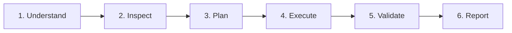

# Production API Engineering System (2026 Standards)

Enterprise engineering methodology for designing, implementing, auditing, and maintaining production-grade APIs across any backend stack.

---

## 1. Non-Negotiable Engineering Laws

1. **Contract-First & API-First**: The machine-readable contract (OpenAPI 3.2.1) is the source of truth, authored and validated before implementing route code.
2. **Never Put Business Logic in Route Handlers**: Controllers parse inputs, invoke domain services, and serialize response DTOs. Zero SQL or business rules in handlers.
3. **Never Expose Database Entities Directly**: Public API contracts must use isolated Request/Response DTOs to prevent mass assignment (BOPLA) and internal schema leakage.
4. **Never Return 200 OK for Errors**: Use accurate RFC 9110 status codes paired with RFC 9457 `application/problem+json` error envelopes.
5. **Never Allow Unbounded Collection Queries**: Enforce context-driven pagination (Cursor/Keyset/Offset) with an absolute ceiling (`limit <= 100`).
6. **Mandatory Object-Level Authorization (BOLA)**: Check tenant and user ownership on every single access to an object identifier.
7. **Safe Retries via Idempotency**: State-mutating operations (`POST`, `PATCH`) must support `Idempotency-Key` (IETF Internet-Draft `idempotency-key-08`) with SHA-256 payload fingerprinting.
8. **Additive Changes by Default**: Never silently modify existing field semantics. All removals or signature changes require RFC 9745 (`Deprecation`) and RFC 8594 (`Sunset`) headers with a minimum 180-day deprecation cycle.

---

## 2. Six-Stage Execution Lifecycle

### Stage 1: Understand
- Identify client consumers (mobile, SPA, 3rd-party webhook, microservice).
- Clarify domain invariants, concurrency model, scale ceiling, and tenant isolation rules.

### Stage 2: Inspect
- Scan existing repository code, routes, ORM models, and existing OpenAPI specs using `python3 scripts/auditApiContract.py`.
- Identify missing error formats, unbounded endpoints, or raw entity leakage.

### Stage 3: Plan
- Author or update OpenAPI 3.2.1 contract (`templates/openapi.yaml`).
- Design request/response DTOs:
  - Success Envelope: `{ "data": T, "meta": Meta }`
  - Error Envelope: RFC 9457 `application/problem+json`
- Select pagination model (see [references/paginationVersioning.md](references/paginationVersioning.md)).
- Conduct OWASP API Security Top 10 threat modeling.

### Stage 4: Execute
- Scaffold route handlers adhering to `policies/mandatory.md` and `policies/security.md`.
- Implement service layer, data validation boundaries, and transaction boundaries (`policies/performance.md`).
- Implement `Idempotency-Key` middleware:
  - Cache active request key $\rightarrow$ return `409 Conflict` if in flight.
  - Verify payload SHA-256 fingerprint $\rightarrow$ return `422 Unprocessable Content` if mismatched.
  - Cache response with TTL $\rightarrow$ replay stored status and payload on identical retry.

### Stage 5: Validate
1. Run contract and security linter: `python3 scripts/auditApiContract.py --spec=openapi.yaml --strict`.
2. Run CI breaking-change detector: `python3 scripts/checkBreakingChanges.py --old=v1.json --new=v2.json`.
3. Assert all tests pass in `evals/evalApiEngineering.py`.

### Stage 6: Report
Produce the final API delivery summary:
- Verified OpenAPI 3.2.1 specification path.
- Enforced security policies and authorization checks.
- Benchmark and latency SLO profile.
- Deprecation schedule (RFC 9745 / RFC 8594) if replacing legacy endpoints.

---

## 3. Core Architecture Separation

| Architectural Layer | Location & Purpose |
| :--- | :--- |
| **Policies** | [policies/mandatory.md](policies/mandatory.md), [policies/security.md](policies/security.md), [policies/performance.md](policies/performance.md), [policies/compatibility.md](policies/compatibility.md) — Enforceable rulebooks. |
| **Methods & References** | [references/responseStandards.md](references/responseStandards.md), [references/openApi32Standards.md](references/openApi32Standards.md), [references/apiSecurityOwasp.md](references/apiSecurityOwasp.md), [references/paginationVersioning.md](references/paginationVersioning.md), [references/databaseTransactions.md](references/databaseTransactions.md), [references/distributedReliability.md](references/distributedReliability.md), [references/contractCompatibility.md](references/contractCompatibility.md), [references/multiTenancy.md](references/multiTenancy.md), [references/apiObservability.md](references/apiObservability.md) — Implementation guides. |
| **Automation Tooling** | `scripts/auditApiContract.py`, `scripts/generateResponseEnvelope.py`, `scripts/checkBreakingChanges.py` — Deterministic CLI tools. |
| **Templates** | `templates/openapi.yaml`, `templates/problemDetails.json`, `templates/apiChecklist.md` — Starter blueprints. |

## 4. Anti-Patterns & Common Traps
| Anti-Pattern | Why It Fails | Production Remediation |
| :--- | :--- | :--- |
| Ad-hoc error objects (`{ "error": "msg" }`) | Breaks client parsing consistency | Enforce RFC 9457 `application/problem+json` envelopes |
| Offset-based pagination on large datasets | Degrades to $O(N)$ scans at high offsets | Use Keyset / Cursor-based pagination (`starting_after`) |
| Unbounded payload responses | Memory exhaustion and network timeouts | Enforce strict `max_page_size` and partial projection |
| Mutating endpoints without idempotency | Duplicate charges and double records on retries | Implement IETF `Idempotency-Key` draft-08 header checks |
