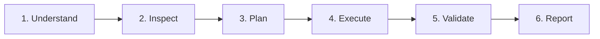

# Database Architecture Engineering System (2026 Standards)

Enterprise engineering methodology for designing, modeling, scaling, auditing, and governing database architectures across relational, non-relational, distributed, and analytical data systems.

---

## 1. Twenty-Four Non-Negotiable Engineering Laws

1. **Workload First**: Never select a database before understanding data volume, read/write ratios, latency SLOs, and access patterns.
2. **Distinct Disciplines**: Never confuse relational normalization with document or distributed database modeling.
3. **Justified Denormalization**: Never denormalize without an explicit, measured read/write bottleneck and a consistency reconciliation plan.
4. **Mandatory Identity**: Never create a table without an immutable primary key; evaluate index locality (UUIDv7 vs BIGINT).
5. **Database-Level Integrity**: Never leave critical data integrity dependent solely on application validation. Enforce NOT NULL, CHECK, UNIQUE, and FOREIGN KEY constraints in the engine.
6. **Judicious Indexing**: Never introduce speculative indexes. Every index incurs write amplification and storage overhead.
7. **Simpler Scaling First**: Never recommend sharding before exhausting query optimization, indexing, connection pooling, and read replicas.
8. **Replication is NOT Backup**: Never assume replication protects against accidental deletion, corruption, or ransomware.
9. **Mandatory Disaster Recovery**: Never deploy a database to production without tested point-in-time recovery (PITR) procedures and verified restore drills.
10. **Zero Secrets in Code**: Never hardcode database credentials, connection strings, or encryption keys in source code or repositories.
11. **Expand-and-Contract Migrations**: Never execute destructive DDL migrations in a single step. All schema changes must be backward-compatible with running application code.
12. **Transaction Scoping**: Never keep database transactions open across external HTTP requests, slow I/O, or message broker dispatch.
13. **Measure Before Optimizing**: Never claim a performance optimization without `EXPLAIN (ANALYZE, BUFFERS)` execution plan evidence.
14. **Portability Awareness**: Never rely on proprietary database extensions without evaluating operational vendor lock-in.
15. **Polyglot Justification**: Never introduce multiple database engines without accounting for cross-engine synchronization, distributed transactions, and operational complexity.
16. **Data Lifecycle Planning**: Never accumulate unbounded records without explicit retention, downsampling, and archival policies.
17. **No Guesses on Scale**: Never treat unverified capacity estimates as production benchmarks.
18. **Evidence of Readiness**: Never certify production readiness without passing the pre-flight verification checklist.
19. **Entity Naming Standards**: Tables must use lowercase `snake_case` plural nouns (`order_items`, `customers`). Generic names (`data`, `info`, `items`, `temp`) and prefixes (`tbl_`) are strictly forbidden.
20. **Lean Schema Law (YAGNI)**: Never add a column until proven necessary by an active business requirement or query pattern. Speculative "just in case" fields and unstructured catch-all columns (`misc`, `extra_data`) are prohibited.
21. **Pre-Creation Security Gate**: No table may be created without completing the pre-creation security checklist (PII classification, tenant isolation `tenant_id`, credential hashing, and RLS review).
22. **Tenant-Aware Composite Foreign Keys**: In multi-tenant databases, foreign keys between tenant-owned entities must enforce composite foreign keys `(tenant_id, target_id) REFERENCES target_table(tenant_id, id)` to prevent cross-tenant record linking.
23. **Temporal Concurrency Protection**: Booking, scheduling, and occupancy tables must enforce PostgreSQL Exclusion Constraints (`EXCLUDE USING gist ... WITH &&`) to prevent overlapping resource allocations.
24. **Complete RLS & Policy Symmetry**: Every table with Row-Level Security enabled must define explicit policies for `SELECT`, `INSERT`, `UPDATE`, and `DELETE` with `WITH CHECK` constraints and `FORCE ROW LEVEL SECURITY`.

---

## 2. Six-Stage Execution Lifecycle

### Stage 1: Understand
- Clarify workload characteristics: OLTP (transactional) vs OLAP (analytical) vs Hybrid.
- Profile volume: Total rows, read/write ratio (e.g. 90/10 vs 50/50), peak IOPS, latency targets (p95 < 20ms).
- Define consistency requirements: Strict serializability vs Read-your-writes vs Eventual consistency.

### Stage 2: Inspect
- Audit existing schemas, constraints, and indexes using `python3 scripts/auditDatabaseSchema.py`.
- Analyze slow query logs, N+1 query patterns, and connection pool saturation metrics.

### Stage 3: Plan
- Generate Architecture Decision Record ([templates/adrTemplate.md](templates/adrTemplate.md)).
- Create conceptual $\rightarrow$ logical $\rightarrow$ physical data models.
- Apply relational normalization (1NF through BCNF) or query-driven NoSQL design ([references/normalizationTheory.md](references/normalizationTheory.md)).
- Complete the mandatory **Pre-Creation Table & Security Gate** ([policies/tableCreationChecklist.md](policies/tableCreationChecklist.md)): Verify entity justification, enforce `snake_case` plural naming, verify YAGNI lean columns, and complete security threat review.
- Design indexing and partitioning strategy ([references/indexingOptimization.md](references/indexingOptimization.md)).

### Stage 4: Execute
- Author DDL schemas strictly adhering to [policies/tableCreationChecklist.md](policies/tableCreationChecklist.md), [policies/integrity.md](policies/integrity.md), and [policies/security.md](policies/security.md).
- Create zero-downtime migration scripts following the expand-and-contract protocol ([templates/migrationPlan.md](templates/migrationPlan.md)).
- Configure connection pools and transaction boundaries ([references/transactionConcurrency.md](references/transactionConcurrency.md)).

### Stage 5: Validate
1. Run schema and constraint linter: `python3 scripts/auditDatabaseSchema.py --schema=schema.sql --strict`.
2. Run migration safety analyzer: `python3 scripts/analyzeMigration.py --migration=migration.sql`.
3. Inspect index suitability and check unindexed foreign keys: `python3 scripts/inspectDatabaseIndexes.py --schema=schema.sql`.
4. Assert all tests pass in `evals/evalDatabaseArchitecture.py`.

### Stage 6: Report
Produce the comprehensive database architecture report:
- Entity Relationship Diagram (ERD) and physical schema definitions.
- Index and partition execution evidence.
- Backup, recovery (RPO/RTO), and disaster recovery validation.

---

## 3. Core Architecture Separation

| Architectural Layer | Location & Purpose |
| :--- | :--- |
| **Policies** | [policies/mandatory.md](policies/mandatory.md), [policies/tableCreationChecklist.md](policies/tableCreationChecklist.md), [policies/integrity.md](policies/integrity.md), [policies/normalization.md](policies/normalization.md), [policies/security.md](policies/security.md), [policies/performance.md](policies/performance.md), [policies/migration.md](policies/migration.md), [policies/recovery.md](policies/recovery.md) — Enforceable rulebooks. |
| **Methods & References** | [references/normalizationTheory.md](references/normalizationTheory.md), [references/databaseTaxonomy.md](references/databaseTaxonomy.md), [references/dataModelingLifecycle.md](references/dataModelingLifecycle.md), [references/scalabilitySharding.md](references/scalabilitySharding.md), [references/indexingOptimization.md](references/indexingOptimization.md), [references/transactionConcurrency.md](references/transactionConcurrency.md), [references/analyticsWarehousing.md](references/analyticsWarehousing.md), [references/backupDisasterRecovery.md](references/backupDisasterRecovery.md) — Deep theory & guides. |
| **Automation Tooling** | `scripts/auditDatabaseSchema.py`, `scripts/analyzeMigration.py`, `scripts/inspectDatabaseIndexes.py` — Deterministic CLI analysis tools. |
| **Templates** | `templates/adrTemplate.md`, `templates/migrationPlan.md`, `templates/databaseChecklist.md` — Enterprise blueprints. |
