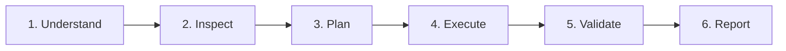

# CI/CD Pipelines & DevOps Engineering

High-leverage engineering guide for robust Continuous Integration, hardened containerization, zero-downtime deployment strategies, and DORA metrics tracking.

---

## 1. Core Principles & Safety Laws

1. **Deterministic & Ephemeral Builds**: Builds must be 100% reproducible. Lockfiles (`pnpm-lock.yaml`, `poetry.lock`, `go.sum`) are mandatory.
2. **Shift Left Security**: Static analysis, credential scanning, and vulnerability audits execute on every commit before merging to trunk.
3. **Hardened Container Invariants**:
   - Always run as non-root user (`USER nonroot` or dedicated UID 10001).
   - Use multi-stage builds to exclude compiler tools from final runtime images.
   - Pin specific base image digests or immutable release tags.
4. **Zero-Downtime Deployment Invariants**:
   - Backward-compatible database migrations (expand-contract pattern).
   - Active readiness and liveness probes before directing production traffic.

---

## 2. Six-Stage Execution Lifecycle



### Stage 1: Understand
- Identify runtime ecosystem (Node/Next.js, Python/FastAPI, Go), target cloud provider, and SLOs.

### Stage 2: Inspect
- Audit existing Dockerfile and pipeline configs using `python3 scripts/auditDockerfileSecurity.py`.
- Verify pipeline cache efficiency and test execution bottlenecks.

### Stage 3: Plan
- Select deployment strategy:
  - **Canary**: 5% $\rightarrow$ 25% $\rightarrow$ 100% traffic shift with automated error budget rollbacks.
  - **Blue-Green**: Instant DNS/router switch between identical production slots.
  - **Rolling**: Node-by-node update with maxUnavailable = 0.

### Stage 4: Execute

#### Standard Multi-Stage Hardened Dockerfile
```dockerfile
# Stage 1: Builder
FROM node:20-alpine AS builder
WORKDIR /app
COPY package.json pnpm-lock.yaml ./
RUN corepack enable && pnpm install --frozen-lockfile
COPY . .
RUN pnpm build

# Stage 2: Minimal Distroless Runtime
FROM node:20-alpine AS runner
WORKDIR /app
ENV NODE_ENV=production
RUN addgroup -S -g 1001 appgroup && adduser -S -u 1001 -G appgroup appuser
COPY --from=builder --chown=appuser:appgroup /app/dist ./dist
COPY --from=builder --chown=appuser:appgroup /app/node_modules ./node_modules
USER appuser
EXPOSE 3000
CMD ["node", "dist/server.js"]
```

#### GitHub Actions / GitLab Generic Pipeline Blueprint
```yaml
name: CI/CD Delivery Pipeline
on:
  push:
    branches: [main]
  pull_request:

jobs:
  validate:
    runs-on: ubuntu-latest
    steps:
      - uses: actions/checkout@v4
      - name: Lint & Static Checking
        run: make lint
      - name: Unit & Integration Tests
        run: make test
  
  security:
    runs-on: ubuntu-latest
    steps:
      - uses: actions/checkout@v4
      - name: Dependency Audit
        run: make audit

  deploy:
    needs: [validate, security]
    if: github.ref == 'refs/heads/main'
    runs-on: ubuntu-latest
    steps:
      - uses: actions/checkout@v4
      - name: Deploy Canary / Production
        run: ./scripts/deploy.sh
```

### Stage 5: Validate
1. Run `python3 scripts/auditDockerfileSecurity.py --file=Dockerfile`.
2. Verify image vulnerability scan passes with 0 Critical/High CVEs.
3. Test graceful shutdown on `SIGTERM` signals.

### Stage 6: Report
Summarize pipeline stage durations, image layer sizes, and DORA telemetry projections.

---

## 3. The 4 DORA Metrics Benchmark

| DORA Metric | Elite Performers | Low Performers |
| :--- | :--- | :--- |
| **Deployment Frequency** | Multiple deploys per day | Fewer than once per 6 months |
| **Lead Time for Changes** | Less than 1 hour | More than 6 months |
| **Change Failure Rate** | 0% - 15% | 46% - 60% |
| **Time to Restore Service** | Less than 1 hour | More than 1 week |

---

## 4. Helper Scripts & Deep References

- Dockerfile Security Linter: `python3 scripts/auditDockerfileSecurity.py`
- Reference: [references/cicdDeploymentPatterns.md](references/cicdDeploymentPatterns.md)

## 5. Anti-Patterns & Common Traps
| Anti-Pattern | Why It Fails | Production Remediation |
| :--- | :--- | :--- |
| Running container as root (`USER root`) | Container breakout privilege escalation | Always enforce `USER nonroot` or dedicated UID/GID |
| Using `:latest` tags for base images | Unpredictable non-deterministic builds | Pin immutable digest (`node:22-alpine@sha256:...`) |
| Storing secrets in Docker image layers | Secrets leaked in public registry pulls | Use build secrets (`--mount=type=secret`) |
| Monolithic serial CI pipelines | Long feedback cycles (> 30 minutes) | Implement matrix parallelization and dependency caching |
