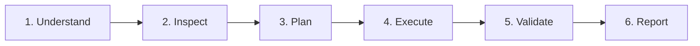

# Git Workflow & Internals

High-leverage engineering guide for mastering Git Directed Acyclic Graphs (DAG), trunk-based development, history surgery, and regression tracking.

---

## 1. Core Principles & Safety Laws

1. **DAG Preservation**: Commits are immutable content-addressable snapshots. Branches and tags are merely pointers.
2. **Never Rewrite Shared History**: Never `push --force` to public tracking branches (`main`, `develop`). Only rewrite local feature branches before integration.
3. **Use Safe Force Pushes**: When pushing rebased feature branches, always use `git push --force-with-lease --force-if-includes`.
4. **Safety Snapshots Before Surgery**: Always capture a backup ref before rebasing: `git branch backup-$(git rev-parse --short HEAD)`.

---

## 2. Six-Stage Execution Lifecycle



### Stage 1: Understand
- Clarify integration target (`main`, `trunk`, or release branch).
- Identify conflict boundaries and linear history requirements.

### Stage 2: Inspect
Run pre-flight checks using `python3 scripts/diagnoseGitGraph.py`:
```bash
git status -sb
git rev-parse --is-inside-work-tree
git merge-base HEAD origin/main
git log --graph --oneline --decorate -n 10
```

### Stage 3: Plan
- Check working directory cleanliness: stash or commit working changes.
- Select workflow: Trunk-based short-lived branches vs Release branches.
- Set up fallback safety bookmark:
  ```bash
  git branch backup-pre-operation
  ```

### Stage 4: Execute

#### A. Trunk-Based Rebase Workflow
```bash
# Fetch latest remote state without switching branches
git fetch origin main

# Rebase feature branch on top of main
git rebase -i origin/main
```

#### B. Automated Regression Isolation with Git Bisect
```bash
# Start bisect session
git bisect start
git bisect bad HEAD
git bisect good <known-good-commit-sha>

# Automated test run script
git bisect run pytest tests/test_regression.py
# or: git bisect run npm test
git bisect reset
```

#### C. Three-Way Merge Conflict Resolution
```bash
# Inspect conflict diff with common ancestor (merge base)
git checkout --conflict=diff3 <conflicted-file>
# Resolve markers: <<<<<<< HEAD (ours) ||||||| merged common ancestors ======= >>>>>>> incoming
git add <conflicted-file>
git rebase --continue # or git merge --continue
```

### Stage 5: Validate
1. Confirm tree is clean: `git status --porcelain`.
2. Verify linear history: `git log --graph --oneline -n 5`.
3. Run project build and test suite: ensure no regressions were introduced during merge/rebase.

### Stage 6: Report
- Output branch status, new commit SHAs, and reflog recovery command (`git reset --hard ORIG_HEAD` or `git reflog`).

---

## 3. Decision Matrix: Merge vs. Rebase

| Requirement | Preferred Strategy | Command |
| :--- | :--- | :--- |
| Pulling remote updates into private feature branch | **Rebase** | `git pull --rebase origin main` |
| Integrating approved PR into main (Trunk-based) | **Squash & Merge** or **Fast-Forward Rebase** | `git merge --ff-only` |
| Preserving complete branch context & timestamp history | **True Merge (No-FF)** | `git merge --no-ff feature/name` |
| Cleaning up messy commit spam before review | **Interactive Rebase** | `git rebase -i HEAD~N` |

---

## 4. Helper Scripts & Deep References

- **Official Git & GitHub CLI Offline Assets**: [assets/](assets/) — Official specifications for Git remotes, DAG concepts, credential caching, and full GitHub CLI (`gh`) reference manual.
- Graph Diagnostics: `python3 scripts/diagnoseGitGraph.py`
- Conflict Resolver Helper: `python3 scripts/resolveConflictHeuristics.py`
- Reference: [references/branchingModels.md](file:///Users/prasangaramanpokharel/projects/SkillFullStack/skills/gitVersionControl/gitWorkflow/references/branchingModels.md)
- Reference: [references/gitInternalsDag.md](file:///Users/prasangaramanpokharel/projects/SkillFullStack/skills/gitVersionControl/gitWorkflow/references/gitInternalsDag.md)
