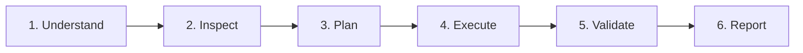

# Requirements Engineering & User Story Modeling

High-leverage engineering guide for rigorous requirements elicitation, user story specification (INVEST), BDD acceptance testing (Gherkin), prioritization, and attack tree derivation.

---

## 1. Core Principles & Quality Standards

1. **INVEST Model for User Stories**:
   - **I**ndependent: Can be developed, tested, and released independently.
   - **N**egotiable: Captures the essence of what is needed, leaving implementation details open.
   - **V**aluable: Delivers clear value to a specific user persona or customer.
   - **E**stimable: Well-enough understood to forecast scope and effort.
   - **S**mall: Fits comfortably within a single sprint iteration (1-3 days of engineering).
   - **T**estable: Accompanied by unambiguous verification criteria.
2. **Behavior-Driven Development (BDD)**: All stories must have acceptance criteria in executable `Given [Context] / When [Action] / Then [Outcome]` format.
3. **Appetite Over Estimate (Shape Up Principle)**: Fix time and cost; vary scope to protect the delivery boundary.

---

## 2. Six-Stage Execution Lifecycle



### Stage 1: Understand
- Identify the target persona, core problem statement, and job-to-be-done (JTBD).
- Separate the business problem from proposed technical solutions.

### Stage 2: Inspect
- Scan existing requirements or issue backlog using `python3 scripts/validateUserStories.py`.
- Identify missing acceptance criteria, oversized stories, or unstated security assumptions.

### Stage 3: Plan (Prioritization Matrix)
Apply MoSCoW prioritization balancing Value vs Cost vs Risk:
- **Must Have**: Critical path, non-negotiable legal/security requirements, system cannot launch without it.
- **Should Have**: High value, but a painful manual workaround exists for launch day.
- **Could Have**: Delight features or minor optimizations if time permits.
- **Won't Have (This Cycle)**: Explicitly excluded to protect timeline and team appetite.

### Stage 4: Execute (Story Specification)

#### Standard INVEST Template
```markdown
### US-101: Secure Multi-Factor Checkout
**As an** authenticated online shopper  
**I want to** verify my high-value purchase ($> $500) via one-time passcode (OTP)  
**So that** fraudulent charges on my stored payment card are prevented.

#### Acceptance Criteria (Given/When/Then)
- **Scenario 1: Successful verification**
  - **Given** my cart value is $650 and I click "Confirm Order"
  - **When** I enter the valid 6-digit OTP received via SMS
  - **Then** the payment is processed and an order receipt is rendered.
- **Scenario 2: Exhausted OTP attempts**
  - **Given** I am prompted for the OTP
  - **When** I fail the OTP attempt 3 consecutive times
  - **Then** the transaction is locked for 15 minutes and security alerts are logged.
```

#### Attack Tree Derivation (Security Requirements)
```
Target: Compromise User Order Session
├── 1. Intercept OTP
│   ├── 1.1 SIM-swap attack (Mitigation: Use WebAuthn / TOTP)
│   └── 1.2 Phishing portal (Mitigation: FIDO2 domain binding)
└── 2. Brute Force OTP
    ├── 2.1 Rapid guessing (Mitigation: Rate limit 3 attempts per 15 min)
    └── 2.2 Replay previous OTP (Mitigation: Single-use TTL = 180s)
```

### Stage 5: Validate
1. Run `python3 scripts/validateUserStories.py --file=requirements.md`.
2. Verify all scenarios are deterministic, testable, and have no ambiguous language ("fast", "user-friendly", "intuitive").

### Stage 6: Report
Produce a finalized requirements package ready for engineering sprint planning.

---

## 3. Helper Scripts & Deep References

- Story Quality Linter: `python3 scripts/validateUserStories.py`
- Reference: [references/requirementsAnalysisModels.md](references/requirementsAnalysisModels.md)

## 4. Anti-Patterns & Common Traps
| Anti-Pattern | Why It Fails | Production Remediation |
| :--- | :--- | :--- |
| Subjective acceptance criteria ("Make it fast") | Non-testable, leads to scope disputes | Quantify metrics ("p95 latency < 200ms at 1000 RPS") |
| Skipping negative/edge scenarios | System crashes on unexpected input | Author explicit Given/When/Then negative test cases |
| Treating MoSCoW "Could-haves" as commitments | Sprint deadline blowouts | Ruthlessly scope down to Must-Haves for initial MVP |
| Functional requirements without threat modeling | Security vulnerabilities discovered post-release | Generate STRIDE / Attack Trees during story refinement |
