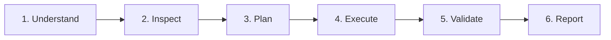

# Test-Driven Development & Test Engineering

High-leverage engineering guide for rigorous TDD cycles, test pyramid balancing, test double selection, and boundary value coverage based on modern software engineering standards.

---

## 1. Core Principles & Laws of TDD

1. **Write No Production Code Without a Failing Test**: Code exists only to make a failing test pass.
2. **Red-Green-Refactor Rhythm**:
   - **RED**: Write the simplest test that expresses the requirement. Confirm it fails for the expected reason.
   - **GREEN**: Write the minimal code required to pass the test. Do not over-engineer.
   - **REFACTOR**: Clean code smells, eliminate duplication, and improve architecture while keeping all tests green.
3. **The Test Pyramid**:
   - **70% Unit Tests**: In-memory, instantaneous (< 10ms), isolated, zero network/disk I/O.
   - **20% Integration Tests**: Component boundaries, real database/repository queries, wire mocks.
   - **10% End-to-End Tests**: Critical user flows, full browser/container environments.

---

## 2. Six-Stage Execution Lifecycle



### Stage 1: Understand
- Identify function contracts, expected invariants, error conditions, and boundaries ($0, 1, N, \infty$, negative numbers, nulls).

### Stage 2: Inspect
Run test pyramid audit:
```bash
python3 scripts/auditTestPyramid.py
```
Check project runner: `vitest run`, `pytest -q`, or `go test ./...`.

### Stage 3: Plan (Boundary Value Matrix)
Construct Equivalence Partitions and Boundary Values:
| Parameter | Partition Valid | Partition Invalid | Boundary Values Tested |
| :--- | :--- | :--- | :--- |
| `quantity` | $1 \le Q \le 100$ | $Q < 1$, $Q > 100$, NaN | `0`, `1`, `50`, `100`, `101` |
| `timestamp` | Past or Present | Future | `now`, `now - 1ms`, `now + 1ms` |

### Stage 4: Execute (Red-Green-Refactor)

#### 1. Write the Failing Test (RED)
```typescript
describe("calculateDiscount", () => {
  it("applies 10% tier when items total exceeds 100", () => {
    const cart = new Cart([{ price: 60 }, { price: 50 }]);
    expect(cart.calculateDiscount()).toBe(11);
  });
});
```

#### 2. Implement Minimal Code (GREEN)
```typescript
export class Cart {
  constructor(private items: { price: number }[]) {}
  calculateDiscount(): number {
    const total = this.items.reduce((acc, cur) => acc + cur.price, 0);
    return total > 100 ? total * 0.1 : 0;
  }
}
```

#### 3. Refactor (REFACTOR)
Extract domain value objects or strategy classes without breaking the test suite.

### Stage 5: Validate
1. Run full test suite with coverage:
   - TypeScript: `npx vitest run --coverage`
   - Python: `pytest --cov=src --cov-report=term-missing`
   - Go: `go test -cover -race ./...`
2. Assert 0 skipped/flaky tests and no unintentional external network calls.

### Stage 6: Report
Generate test summary including assertion count, execution time, and coverage delta.

---

## 3. Test Double Taxonomy (When to Use What)

| Double Type | Role | When to Use |
| :--- | :--- | :--- |
| **Dummy** | Passed around but never actually used (e.g., filling required constructor args). | Satisfying strict type signatures where value is irrelevant. |
| **Stub** | Provides canned answers to calls made during the test. | Simulating third-party API payloads or database reads. |
| **Spy** | Records information about how it was called (arguments, call counts). | Verifying side effects (e.g., verifying telemetry or mailer sent). |
| **Mock** | Pre-programmed with expectations of specific calls; fails if expectations unmet. | Enforcing protocol contracts and interactions. |
| **Fake** | Working implementation with a shortcut (e.g. in-memory SQLite / Map). | High-speed integration tests replacing external databases. |

---

## 4. Helper Scripts & Deep References

- Test Pyramid Auditor: `python3 scripts/auditTestPyramid.py`
- Reference: [references/testPyramidDoubles.md](file:///Users/prasangaramanpokharel/projects/SkillFullStack/skills/testing/testDrivenDevelopment/references/testPyramidDoubles.md)
